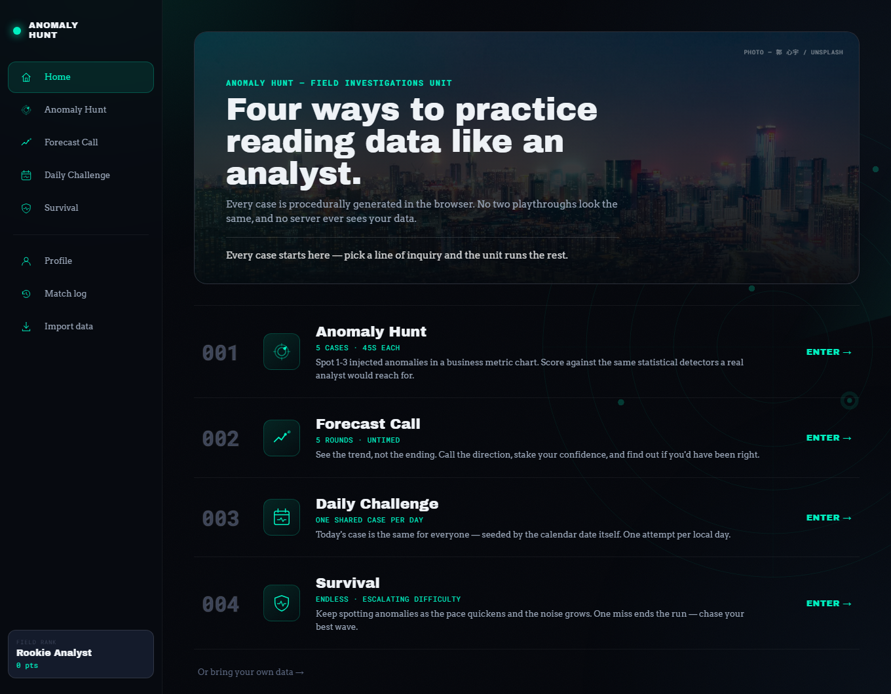
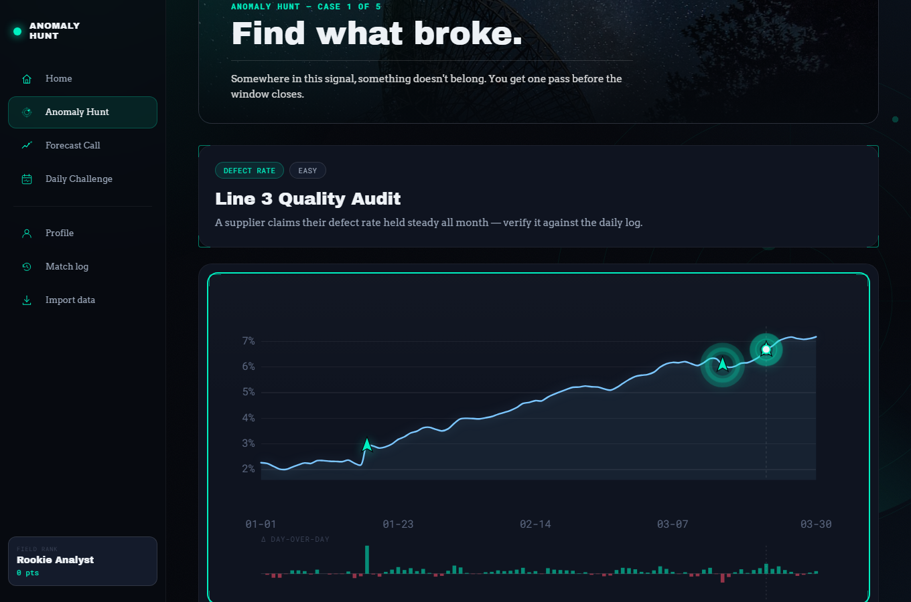
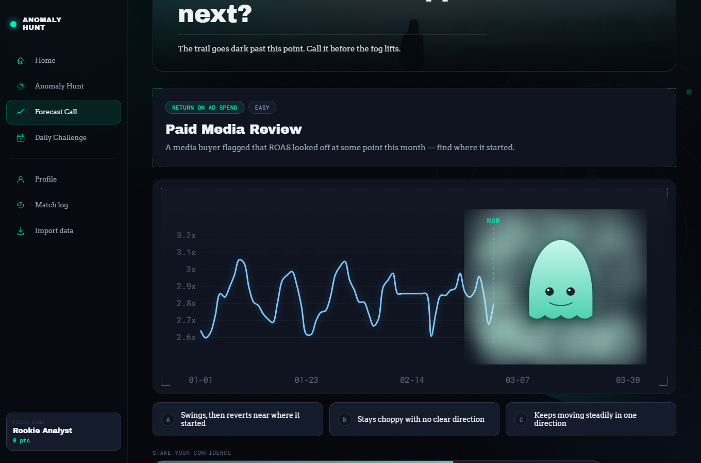
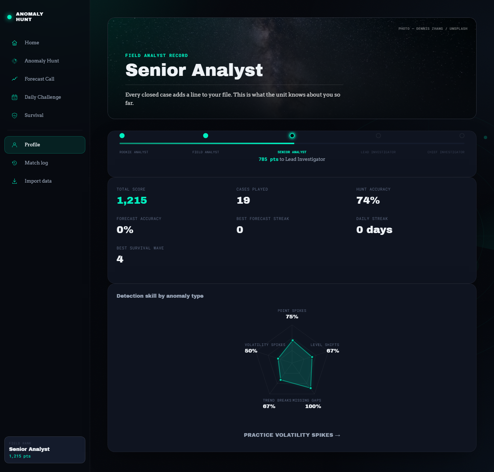
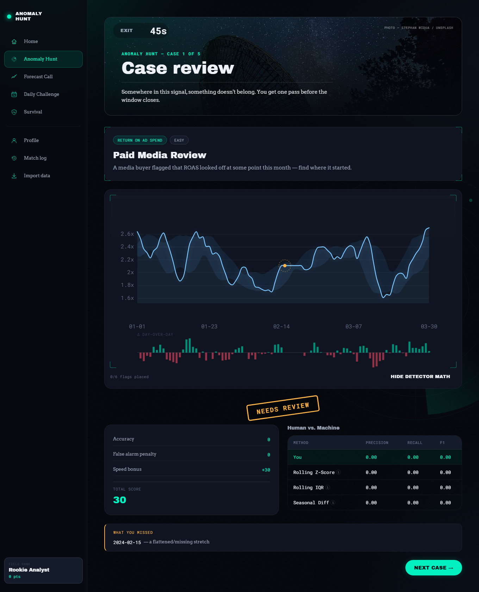

# 🔍 Anomaly Hunt


An open-source field-investigations game for practicing real BI/analytics
skills: spotting anomalies in business data, forecasting where a trend
goes next, and comparing your own judgement to real statistical methods.
Every case is procedurally generated in the browser — no two playthroughs
look the same, and no server ever sees your case data, scores, or match
history.

**[Play the live demo →](#)** *(add your GitHub Pages link here after deploying)*



### At a glance

- **Four modes, one shared engine** — Anomaly Hunt (timed), Forecast
  Call (untimed MCQ), Daily Challenge (one shared case a day), Survival
  (endless, escalating difficulty, one miss ends the run) — plus a fifth
  way in: bring your own CSV/JSON instead of a generated case.
- **No backend for your data.** Every case is generated in your browser;
  your profile, rank, and match history live in `localStorage` only —
  none of it is ever sent anywhere. (The page does fetch Google Fonts at
  load time, like most sites that use them — see
  [Known limitations](#known-limitations) for the honest caveat on that.)
- **Real statistics, not flavor text.** Three transparent anomaly
  detectors and a genuine precision/recall/F1 comparison against your
  own picks — see [`docs/methodology.md`](docs/methodology.md) for the
  reasoning behind every scoring and detection rule.
- **Teaches, not just scores.** The reveal screen names what you missed
  in plain English, shows the detector's own rolling-mean/std math on
  request, and glossary tooltips explain each method — see
  [Learning from every case](#learning-from-every-case).
- **Tested and hardened**, not just demoed — a Vitest suite covers the
  engine layer (including regression tests for several real, measured
  bugs from development), CI runs that suite before every deploy, and
  the shipped page carries a strict Content-Security-Policy with zero
  relaxations.
- **Keyboard-accessible.** The chart itself — the core interaction — is
  fully operable without a mouse, with live-region announcements for
  screen readers.

### Contents

- [Look and feel](#look-and-feel)
- [Four investigations, one engine](#four-investigations-one-engine)
- [The interaction](#the-interaction)
- [Learning from every case](#learning-from-every-case)
- [How it works](#how-it-works)
- [Testing, reliability & security](#testing-reliability--security)
- [Repo structure](#repo-structure)
- [Getting started](#getting-started)
- [Known limitations](#known-limitations)
- [Roadmap / good first issues](#roadmap--good-first-issues)
- [License](#license)

## Look and feel

The whole app is framed as a fictional "Field Investigations Unit": a
persistent sidebar console instead of a page-per-screen layout, each
mode opening on a themed case-file banner (a real, credited photo with a
dark teal duotone treatment, never a raw stock-photo drop) and a short
in-world caption tying it back to the unit's story. Before a timed round
actually starts, a **ready screen** lets you read the case brief first —
the clock (Anomaly Hunt, Daily Challenge) never starts ticking until you
click through it, and even untimed Forecast Call gets the same calm
beat before the hidden data locks away. Switching screens in the sidebar
sweeps the new one in with a spring-based "swoosh" rather than a plain
fade.

## Four investigations, one engine

All four modes are built on the same procedurally-generated
business-metric library (`web/src/engine/metrics.js`) — seven metric
templates (revenue, active users, support tickets, defect rate, response
time, ad ROAS, churn rate), each randomized every time, so the underlying
data engine is shared rather than duplicated per mode.

### 🕵️ Anomaly Hunt
Five cases, 45 seconds each. A business metric is shown with 1–3 injected
anomalies — point spikes, level shifts, missing-data gaps, trend breaks,
or volatility spikes (a short burst of erratic noise around an otherwise
unchanged baseline). Click, or press-drag-release a dart onto the chart
to flag what looks wrong before time runs out. Scoring is
**distance-based**: a flag near the true anomaly earns partial credit
that fades with distance — both in days and in value — not an
all-or-nothing exact match (up to 6 flags per case). After each case,
compare your picks to three real statistical detectors (rolling z-score,
rolling IQR, a weekly-seasonal-diff method) run against the same data,
with a real precision/recall/F1 "Human vs Machine" table — your score
computed with the exact same methodology as the detectors, not a
different metric dressed up to look comparable.



### 📈 Forecast Call
Five rounds, no timer. See a real trend with the final stretch hidden,
then answer a multiple-choice question about what happens next —
direction, a numeric range, magnitude of change, pattern, or a
business-framed interpretation, picked at random each round. Every
option (the correct answer and the distractors) is computed from the
actual generated data, never hard-coded. Before locking in an answer,
you stake a confidence level (low/medium/high) that amplifies **both**
the reward for being right and the penalty for being wrong — the game
is testing calibrated judgement, not just correctness.



### 📅 Daily Challenge
One deterministic, date-seeded Anomaly Hunt case shared by everyone who
plays that day — the calendar date itself is the random seed, so no
backend or server-assigned puzzle is needed. One attempt per local day.

### 🛡️ Survival
Endless mode: cases keep coming, one wave at a time, with anomaly count
and subtlety both escalating as you go (`survivalSettingsForWave()` in
`anomalies.js`) — the ramp holds at a steady, tough-but-survivable
ceiling past wave 13 rather than escalating forever, so a skilled run
never becomes mathematically unwinnable. One missed anomaly ends the
run (false alarms still cost points but don't end it by themselves);
reaching wave N — even the wave that ends the run — counts toward your
best-run stat, tracked on the Profile screen.

### 📥 Bring your own data
Anomaly Hunt doesn't have to run on a procedurally-generated case — drop
in your own CSV or JSON file (date + numeric value columns, flexible
column-name aliases, tolerant of messy real-world exports including
quoted/thousands-separated numbers, capped at 5 MB) and the unit builds
a case on your real shape instead of a template. To be precise about
what that means: practice irregularities still get woven into your real
values the same way every other case is built — this isn't a tool for
surfacing anomalies that may already be in your data, it's your own
realistic baseline standing in for a template's. Everything stays in
your browser; nothing is uploaded anywhere.

### Progression
A lightweight local rank system (`web/src/engine/profile.js`) derives
lifetime stats purely from your match history (`web/src/engine/history.js`)
— total score, hunt/forecast accuracy, best forecast streak, daily
streak, and per-anomaly-type detection skill — and shows an analyst rank
on the home screen (Rookie Analyst → Chief Investigator). Everything is
a live projection of the history log, never stored separately, so it can
never drift out of sync. History and local-only "personal best" boards
(`leaderboard.js`) live entirely in `localStorage`; clearing it from the
History screen gives you a clean slate.



## The interaction

The chart itself is the only input: **click a point to flag it, or
press and drag a dart onto the chart and release** — the dart follows
your cursor with real spring physics while held, and snaps to the
nearest day on release, reading its position back from the exact same
scale the line is drawn with, so "lands exactly on the curve" is
structural rather than something re-verified by hand per case. A second
tap on a flagged point removes it.

The same chart is fully keyboard-operable too: focus it and use **Left
/ Right to move between days, Enter or Space to flag or unflag the
focused one** — a live region announces the day, value, and flagged
state as you move, since the pointer path's visual hover readout alone
wouldn't reach a screen-reader user.

## Learning from every case

The reveal screen doesn't just score you — it explains:

- **What you missed** — each missed anomaly is named in plain English
  ("a level shift", "a burst of erratic noise"), not just marked wrong,
  so a miss builds a mental taxonomy instead of staying an unexplained
  red mark.
- **Detector reasoning, on request** — a "Show detector math" toggle
  overlays the rolling z-score detector's own mean ± std band on the
  chart, the exact baseline it judged every point against.
- **Glossary tooltips** on each detector's name in the Human vs Machine
  table, so "Rolling IQR" doesn't have to be taken on faith.
- **Practice your weakest skill** — the Profile screen's radar chart
  tracks your hit rate per anomaly type; a one-click CTA builds a case
  entirely out of whichever type you're worst at.
- **Replay it live** — an alternate start on Anomaly Hunt's ready screen
  reveals the case one day at a time instead of all 90 at once, testing
  real-time judgement instead of hindsight pattern-matching on a static
  chart. The chart's y-axis stays locked to the case's full range the
  whole time (not rescaled as new days arrive) so the test stays "can
  you still catch it without seeing the ending," not a second, noisier
  test of coping with a moving axis.

## How it works

1. **Data generation** — happens entirely client-side, no backend, no
   pre-built files. Each mode's generator (`case.js` / `forecast.js` /
   `daily.js`) picks a random metric template, randomizes its
   parameters, and (for Anomaly Hunt) injects labeled anomalies spaced
   far enough apart that no single flag can double-count credit.
2. **Distance-based scoring in Anomaly Hunt, confidence-calibrated
   scoring in Forecast Call** — both fade smoothly rather than using an
   exact-match cliff or a flat right/wrong.
3. **Statistical comparison** — after an Anomaly Hunt case, three
   lightweight detectors run against the same series, with the point
   under test always excluded from its own baseline window (a naive
   rolling window otherwise lets one strong outlier vouch for its own
   normalcy), so you can see where your judgment agreed or disagreed
   with a transparent model.
4. Finish all rounds and the session score is broken down case by case,
   then logged to your local match history.



## Testing, reliability & security

```bash
cd web
npm test          # run the suite once
npm run test:watch
```

**Tested.** The engine layer (`web/src/engine/*.js`) — the part that
actually has to be statistically correct — has a
[Vitest](https://vitest.dev) suite covering every module, including
regression tests for defects that were real, measured bugs during
development and are exactly the kind of thing that could silently
reappear without a test catching them:

- **Self-inclusion bias in the rolling detectors** — a hand-computed
  scenario asserting a window never lets the point under test vouch for
  its own normalcy (see "Detection methods" in
  [`docs/methodology.md`](docs/methodology.md)).
- **The Forecast Call range-question band-width floor** — asserting the
  answer band can never collapse to a degenerate zero-width option on a
  metric pinned near its own floor.
- **Zero-deviation-at-the-flagged-point** — both `trend_break` and
  `volatility_spike` guard against the same failure mode: a point
  computed purely from a formula (a slope, a random noise draw) can land
  near zero by chance and make the one point a player is asked to find
  look completely normal. Each type's injection guarantees a real
  deviation exactly at its own index instead of leaving it to chance.

The GitHub Actions deploy workflow runs this suite before every build —
a failing test blocks the deploy, it doesn't just sit unread locally.

**Resilient.** Each screen is lazy-loaded (`React.lazy`) and wrapped in
an error boundary, so a screen that fails to load — or throws — shows a
small in-theme recovery panel with a way back to Home instead of a
blank white screen.

**Hardened.** The shipped page carries a strict
[Content-Security-Policy](https://developer.mozilla.org/en-US/docs/Web/HTTP/CSP)
(`default-src 'self'`, no `unsafe-inline`, no `unsafe-eval`) as
defense-in-depth — there's no known XSS vector in the app today (no
`dangerouslySetInnerHTML`, `eval`, or raw `innerHTML` anywhere; every
user-facing string renders through React's auto-escaping JSX), but the
policy means a future regression would be blocked rather than exploited.
The CSV/JSON import path is capped at 5 MB to stop an oversized or
mis-selected file from freezing the tab, and the hand-rolled CSV parser
walks the string char-by-char rather than using regex, so there's no
ReDoS surface there either.

## Repo structure

```
anomaly-hunt/
├── web/                                 # the game — fully self-contained
│   ├── src/engine/                     # the game's logic, zero UI code
│   │   ├── rng.js                      # seedable PRNG (mulberry32) + Gaussian sampler
│   │   ├── metrics.js                  # business-metric templates, formatting, unit floors
│   │   ├── anomalies.js                # injects 1 of 5 labeled anomaly types (spaced to avoid double credit)
│   │   ├── detectors.js                # z-score / IQR / weekly-diff, self-exclusion built in, each returns its own math
│   │   ├── scoring.js                  # Anomaly Hunt distance-based + Forecast confidence scoring
│   │   ├── case.js                     # builds one playable round from a template, imported data, or a Survival wave
│   │   ├── daily.js                    # date-seeded deterministic Daily Challenge
│   │   ├── forecast.js                 # Forecast Call: builds the MCQ + distractors
│   │   ├── dataImport.js               # parses an imported CSV/JSON series (quote-aware, 5 MB capped)
│   │   ├── profile.js / leaderboard.js / history.js   # localStorage persistence
│   │   ├── useFlagging.js / useCountdownTimer.js   # shared hooks behind Anomaly Hunt + Daily Challenge
│   │   └── *.test.js                   # vitest coverage for every file above — see Testing, reliability & security below
│   ├── src/charts/                     # hand-rolled d3-scale/d3-shape charts, no chart library
│   │   ├── useChartScales.js           # the ONE exact-domain scale every marker shares
│   │   ├── AnomalyChart.jsx            # press-drag-release dart (+ full keyboard path), detector + rolling-band overlay
│   │   ├── RollingBand.jsx             # the toggleable rolling mean ± std band behind the chart line
│   │   ├── ForecastChart.jsx / ChartShadow.jsx   # cutoff + the fog-bank/ghost hidden-region reveal
│   │   ├── RadarSkillChart.jsx         # Profile's per-anomaly-type detection skill chart (N axes, generic)
│   │   └── ChartGrid.jsx / SeriesPath.jsx
│   ├── src/components/                 # shared design-system pieces (Button, Card, Pill, …)
│   │   ├── AppShell.jsx                # persistent sidebar + ambient background, mounted once
│   │   ├── ReadyGate.jsx               # the "read the brief, then start" pause before a round
│   │   ├── CaseRevealPanel.jsx         # the shared "case closed" block (stamp, breakdown, detector table, miss explanations)
│   │   ├── InfoHint.jsx                # portaled hover/focus glossary tooltip, escapes clipping ancestors
│   │   ├── PageShell.jsx               # per-screen header, incl. the photo case-file banner
│   │   ├── ConfirmDialog.jsx / CommandPalette.jsx / ToastHub.jsx   # modal, ⌘K palette, achievement toasts
│   │   └── ErrorBoundary.jsx / ScreenLoader.jsx   # per-screen crash/chunk-load recovery + lazy-load fallback
│   ├── src/screens/                    # one folder per screen: Home, AnomalyHunt, ForecastCall,
│   │                                    #   DailyChallenge, Survival, Profile, History, Import
│   ├── src/assets/photos/              # credited Unsplash photos for each screen's case-file banner
│   ├── src/design/                     # tokens.css (incl. the global focus-ring), animations.css
│   ├── src/App.jsx                     # screen switcher, lazy-loaded per screen, page-transition shell
│   └── vite.config.js                  # also wires up the vitest test runner (`test` block)
├── docs/methodology.md                 # the statistical reasoning behind every scoring/detection rule
├── .github/workflows/deploy.yml        # auto-deploys to GitHub Pages on push
├── start.sh / start.bat                # one-command local run (installs + starts dev server)
└── LICENSE
```

## Getting started

**Quickest way — one script does everything:**

```bash
git clone https://github.com/<your-username>/anomaly-hunt.git
cd anomaly-hunt
./start.sh        # Mac/Linux
start.bat         # Windows (or just double-click the file)
```

**Or manually, same result:**

```bash
git clone https://github.com/<your-username>/anomaly-hunt.git
cd anomaly-hunt/web
npm install
npm run dev
```

Either way, all four game modes generate their own data live in the
browser — nothing to run before `npm run dev`.

Open the local dev URL Vite prints once either command finishes.

To deploy for real, push to `main` — the included GitHub Actions workflow
builds and deploys to GitHub Pages automatically (enable Pages in your
repo's Settings → Pages → Source: GitHub Actions).

## Known limitations

- **The page fetches Google Fonts at load time** (`fonts.googleapis.com`
  / `fonts.gstatic.com`, allow-listed in the CSP) — like the vast
  majority of sites that use them, this means a visitor's browser makes
  a request to Google's CDN, which sees that visitor's IP address the
  same way any font/CDN request would. No game data, scores, or history
  are ever part of that request or sent anywhere else — this is the one
  caveat on the "no server ever sees your data" claims elsewhere in this
  document, and it's called out here rather than left implicit.
- **All data is synthetic**, generated procedurally in the browser — not
  real business data, and isn't claiming to be. The goal is realistic
  *shape* (seasonality, trend, noise), not real-world accuracy.
- The **weekly-seasonal-diff detector** is a lightweight stand-in for
  proper seasonal decomposition (e.g. STL) — simple enough to run live
  in the browser, not a research-grade method.
- The **credit radius (Anomaly Hunt) and confidence multipliers
  (Forecast Call)** are fixed values, not tuned per metric or per
  player.
- **Survival's difficulty ramp is a hand-tuned curve**
  (`survivalSettingsForWave()`), not something derived from actual player
  data on what's fair at each wave — it's a reasonable first pass, not a
  claim of being balanced.
- **Profile, history, and personal bests are local to one browser**
  (`localStorage`) — no identity, no cross-device sync. Note that
  `localStorage` is scoped per *origin*, not per repo: if you deploy
  other projects to GitHub Pages under the same account, they share
  this same storage namespace (keys here are prefixed `ah2-` to avoid
  accidental collisions, but that's not isolation).
- Forecast Call always forecasts the same fixed fraction of the series —
  no adjustable forecast horizon yet.

## Roadmap / good first issues

- [ ] Add more business-metric templates for even more variety
- [ ] Add a shared online leaderboard (small serverless function + DB) —
  would also let Survival's best-wave stat be a real, comparable
  high-score board instead of only a personal local one
- [ ] Add difficulty-adaptive case selection to the standard (non-Survival)
  5-case Anomaly Hunt sequence, based on player performance
- [ ] Add an adjustable forecast horizon to Forecast Call
- [ ] Port a higher-fidelity seasonal decomposition to JS
- [ ] Add a fifth mode: a **Data Quality** challenge (spotting missing
  values, duplicates, invalid records, timestamp problems in synthetic
  tabular data) — deliberately not started yet, to keep the existing
  modes the focus rather than spreading across several half-finished ones

Contributions welcome — open an issue or PR.

## License

MIT — see [LICENSE](LICENSE).
